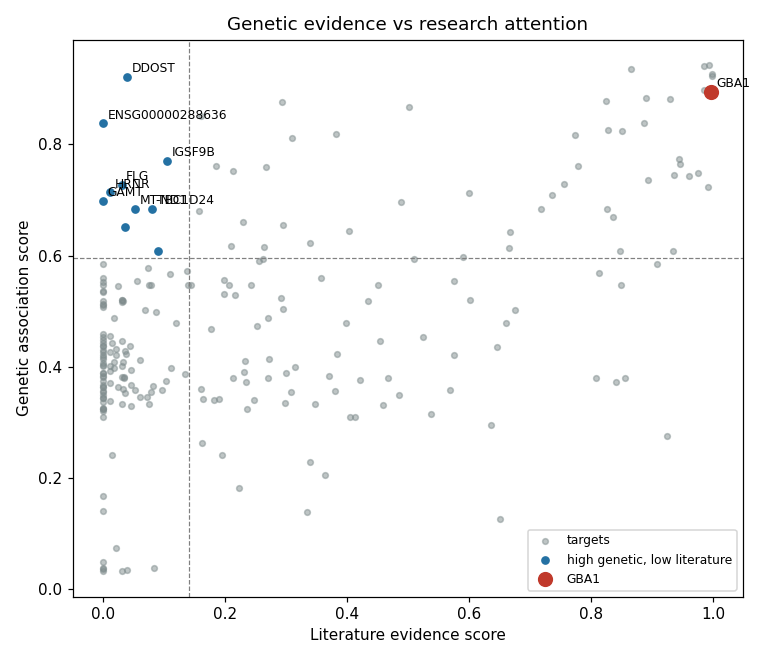

# Genetic evidence vs research attention for Parkinson's disease targets

**Question:** Which Parkinson's disease drug targets have strong human genetic evidence but relatively little research attention, and where does GBA1 sit?

**Data:** Open Targets Platform (target–disease association scores) and the GWAS Catalog (genetic variant associations), downloaded automatically in Python.

**Key findings:**
- GBA1 ranked 11 of 1000 targets by overall association score.
- Genetic and literature scores were moderately correlated (Spearman rho =  0.41).
- Targets with high genetic but low literature evidence included [genes].

**Files:** `parkinsons_targets.ipynb` (full analysis and write-up) · `fig1_top20.png` · `fig2_genetic_vs_literature.png` · `fig3_manhattan.png`
